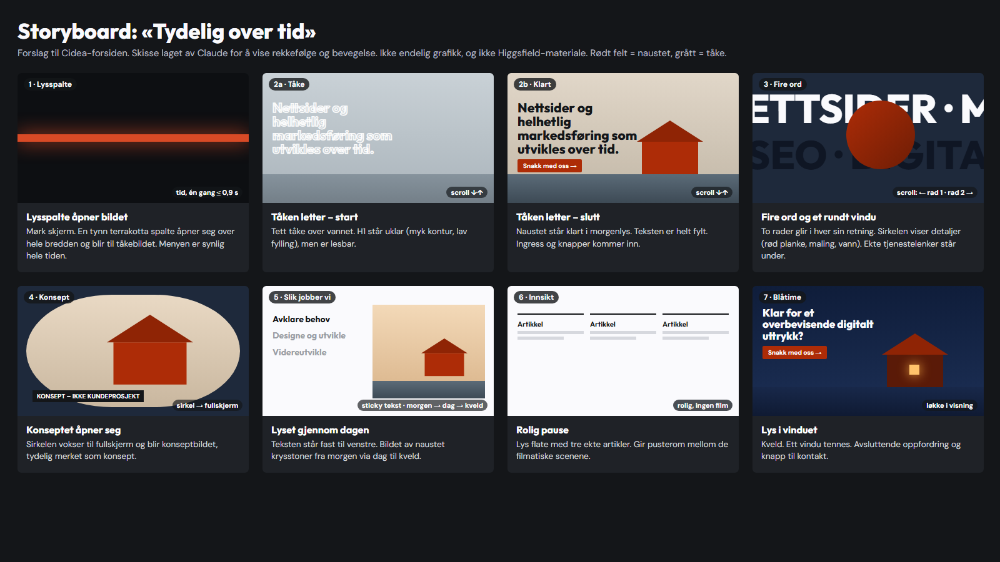

# Cidea-forslag: «Tydelig over tid»

**Status:** forslag til eier og ChatGPT. **Ikke godkjent.** Ingen kode er endret, og ingenting er generert i Higgsfield.
**Grunnlag:** [ANALYSE.md](ANALYSE.md) (Dentsu Creative, observert 2026-10-18) og eiers retning: levende og filmatisk forside med wow-følelse, vanlige undersider, eget uttrykk, ingen bilder av nettsider i heroen. Tidligere figurer og storyboard er ikke førende.

## 1. Konseptet i én setning

**Tåken letter over et rødt naust ved sjøen mens du scroller, og teksten blir tydelig sammen med bildet: fra uklart til tydelig, og fra usynlig til synlig, slik Cidea gjør bedrifter over tid.**

Hvorfor dette:
- **Det er Cideas løfte.** H1-en er «Nettsider og helhetlig markedsføring som utvikles over tid». Synlighet (SEO), tydelighet (merkevare) og kontinuerlig forbedring vises som én fysisk hendelse, ikke som ikoner.
- **Det er eget og norsk.** Et rødt naust i tåke er kjent, varmt og ikke en kopi av noe byrå. Fargen ligger allerede i Cideas palett (terrakotta `#D84A26` / dyp `#AD2C07`). Ingen nettsideskjermer, ingen geometriske figurer.
- **Det bruker Dentsus prinsipper, ikke Dentsus uttrykk** (se analysen § 6):

  | Dentsu | Cidea |
  |---|---|
  | Hel flate som forvandles | Tåke som letter |
  | Kontur → fylt tekst | Uklar → tydelig tekst |
  | Gigantiske ord som glir i hver sin retning, med bilde i sirkel | Cideas fire tjenester |
  | Rolige hvite seksjoner mellom de filmatiske | Samme rytme |

- **Det unngår Dentsus svakheter.** Nettleserens egen scroll, ekte redusert bevegelse, ingen laster som skjuler innhold, og `aria-expanded` på menyen (den finnes allerede hos oss).

## 2. Storyboard – 7 nøkkeløyeblikk

Skissen er laget av Claude for å vise rekkefølge og bevegelse. Den er ikke endelig grafikk. Scroll er drivkraften. Alt går begge veier. Tekst er ekte HTML hele veien.

| # | Øyeblikk | Bilde | Tekst (godkjent copy) | Bevegelse | Drivkraft |
|---|---|---|---|---|---|
| 1 | **Lysspalte** (0–0,9 s) | Mørk skjerm. En tynn horisontal spalte i terrakotta åpner seg over hele bredden og blir til bildet: tett, blågrå tåke over stille vann | Meny og logo er synlige fra første bilde | `clip-path`-åpning, én gang, ≤ 900 ms | Tid (én gang) |
| 2 | **Tåken letter** (hero, festet ca. 160vh) | Samme kamera, låst: tåken trekker seg tilbake og et rødt naust kommer frem i vannkanten. Lyset går fra blågrått til varm morgen | H1: «Nettsider og helhetlig markedsføring som utvikles over tid.» Linjene går fra uklare (myk kontur og lav fylling) til helt fylte i takt med bildet. Ingress og «Snakk med oss» / «Se konseptet» kommer til slutt | Bildesekvens (ca. 60 rammer) skrubbet mot scroll. Tekstfylling via CSS-variabel | Scroll |
| 3 | **Fire ord** (tjenester) | Mørk marine `#1E293B`. Et rundt «vindu» midt på skjermen viser detaljer fra samme sted: våt treplanke, maling som trekkes ut, ringer i vannet | To rader i Outfit 800 med ekstrem skala. Rad 1 glir mot venstre: «NETTSIDER · MERKEVAREBYGGING». Rad 2 glir mot høyre: «SEO · DIGITAL MARKEDSFØRING». Under: dagens fire tjenestelenker med godkjent tekst | Horisontal forskyvning og sirkel som vokser fra 30 % til 60 % av bredden | Scroll |
| 4 | **Konseptet åpner seg** | Sirkelen vokser til fullskjerm og blir konseptbildet | «Konsept – ikke kundeprosjekt» og konseptteksten (fase 3) | Sirkelmaske → fullskjerm, deretter vanlig scroll | Scroll |
| 5 | **Slik jobber vi – lyset gjennom dagen** | Samme naust i tre lys: morgen, dag og kveld. Bildet krysstoner mellom dem | «Avklare behov», «Designe og utvikle», «Videreutvikle». Tekst står fast til venstre (sticky), bildet skifter til høyre | Krysstoning per steg | Scroll (CSS `position: sticky`) |
| 6 | **Innsikt – rolig pause** | Lys flate `#FAFAFD`, ingen film | Tre ekte artikler som i dag | Ingen, eller kort innfading | – |
| 7 | **Blåtime – lys i vinduet** | Kveld. Naustet i blått lys, ett vindu tennes varmt | «Klar for et overbevisende digitalt uttrykk?» + setningen + «Snakk med oss →» | Kort løkke (vindu tennes, vann beveger seg) som starter når seksjonen er i visning. Pauses utenfor visning | Visning (IntersectionObserver), ikke scroll |

Tidslinjen gjenspeiler budskapet: morgen (avklare) → dag (utvikle) → kveld (videreutvikle), og lyset er tent når du er klar for å ta kontakt.

## 3. Materiale Higgsfield må produsere

Felles regler:
- Samme sted, samme naust og samme kamerahøyde i alle opptak. Fotografisk, naturlig uttrykk.
- **Ingen tekst, logoer, skilt eller ansikter.** Ingen nettsider eller skjermer.
- Sjekk hvert opptak for typiske KI-feil i bygget: vinduer, takskjegg og speiling i vannet.

| # | Leveranse | Format | Lengde | Kamera og innhold | Brukes i |
|---|---|---|---|---|---|
| H1 | **Hero: tåken letter** (desktop) | 16:9, minst 1920 × 1080, uten lyd | 6–8 s | Låst kamera, ingen bevegelse. Tett tåke → klart, rødt naust i vannkanten, stille vann, morgenlys. Jevn fart, ingen kutt | 1, 2 |
| H2 | **Hero: tåken letter** (mobil) | 9:16, minst 1080 × 1920 | 6–8 s | Samme scene komponert stående. Naustet i nedre tredjedel, plass til tekst over | 1, 2 |
| H3 | Detaljløkker til sirkelvinduet | 1:1, minst 1080 × 1080 | 3–4 s × 3 | (a) våt treplanke i rødt, (b) pensel som trekker rød maling, (c) ringer i vannet. Sømløs løkke | 3 |
| H4 | Konseptbilde | 16:9 + 9:16 | stillbilde | Naustet nærmere, morgenlys, rolig komposisjon med luft til tekst | 4 |
| H5 | Tre lys | 16:9 + 9:16 | stillbilder × 3 | Identisk utsnitt i morgen, dag og kveld | 5 |
| H6 | Blåtime med vindu som tennes | 16:9 + 9:16 | 4–5 s, sømløs løkke | Låst kamera, blått kveldslys, ett vindu går fra mørkt til varmt | 7 |

**Prioritet innen prøvekredittene** (110 tilgjengelige ved forrige måling; en 6 s test er tidligere priset til 42 kreditter): først **H1** som én prøve, og deretter vurdering. H2–H6 bestilles bare etter at H1 er godkjent visuelt. Hele listen vil trolig overstige prøven. Pris må avklares av eier før kjøp.

**Hvis Higgsfield ikke gir fotografisk kvalitet:** lisensiert stockvideo eller eget opptak av et ekte naust. Det er en kostnadsbeslutning for eier, og skal ikke antas.

## 4. Plan for hva Claude bygger

Bare forsiden endres. Undersider, meny, bunntekst, artikler, `/kontakt`, forhåndsrendring og testoppsettet beholdes.

| Trinn | Innhold | Ferdig når |
|---|---|---|
| A. Prototype med plassholdere | Scene 1–7 med enkle plassholderbilder, `position: sticky`-scener, scroll-motor (passiv `scroll`-lytter + `requestAnimationFrame` som beregner fremdrift 0–1 per scene og setter CSS-variabler). **Ingen scroll-bibliotek, ingen egendefinert scroll.** | Sekvensen virker begge veier og `window.scrollY` er ekte |
| B. Bildesekvens | Rammer trekkes ut av H1/H2 (ffmpeg), AVIF + WebP. Desktop: 60 rammer à 1600 px. Mobil: 40 rammer à 720 × 1280. Første og siste ramme som vanlig `` i forhåndsrendret HTML. Øvrige rammer lastes etter første visning og tegnes på `<canvas>` | LCP-bildet er ≤ 150 kB og resten lastes uten å blokkere |
| C. Typografi og tekst | Outfit 800 for displayord (variabel font, allerede selvhostet). H1 «uklar → tydelig» med `-webkit-text-stroke` + fyllgrad via `--p`. **Starttilstanden skal fortsatt være lesbar** (minst 4,5:1 med fylling, ikke bare kontur). Skissen (ramme 2a) viser problemet: hvit kontur på lys tåke er nesten uleselig. Tåkebildet må derfor starte mørkt nok, ellers må teksten være mørk og fylt. Horisontale ord er `aria-hidden` dekor, og de ekte tjenestelenkene ligger under | Kontrast og overskrifter består `tests/qa.mjs` |
| D. Ekte bilder | Bytte plassholdere med godkjent Higgsfield-materiale | Eier og ChatGPT godkjenner bildene |
| E. Kvalitet | Utvide `tests/forside.test.mjs`: ekte `scrollY`; passive lyttere og ingen `preventDefault` på hjul eller berøring; begge retninger; redusert bevegelse = stillbilde; uten JS = siste tydelige ramme og all tekst; CLS < 0,1; p95 bildetid under 4× CPU-struping; 0 overflow ved 320–1440. Visuell QA i Chromium, Firefox og WebKit | Alle tester grønne og skjermbilder vurdert av eier |

Ytelsesbudsjett: forsiden ≤ 1,5 MB før scroll på mobil, LCP < 2,5 s på 4G-emulering, ingen lange oppgaver > 200 ms under scroll.

## 5. Mobilversjon

- Samme sju øyeblikk, men egne stående bilder (H2 og 9:16-varianter) i stedet for beskåret desktopbilde.
- Kortere festing: hero ca. 120vh, ingen annen festing lenger enn 100vh.
- Displayord rundt 26vw (Dentsu: 101 px ved 390). Sirkelvinduet 70vw. Tjenestelenkene i én kolonne under.
- Nettleserens egen berøringsscroll uten treghetsmanipulering. Ingenting avhenger av hover.
- Dagens tilgjengelige mobilmeny beholdes («Meny»/«Lukk», `aria-expanded`, Escape, fokusretur).
- Lavere bildefrekvens i sekvensen og mindre filer. Ved `Save-Data` eller treg linje vises stillbilder i stedet for sekvens.

## 6. Redusert bevegelse

Med `prefers-reduced-motion: reduce` (og uten JavaScript):
- Ingen lysspalte, ingen skrubbing og ingen festing. Heroen viser **siste, klare ramme** som stillbilde med fylt tekst.
- Fire ord står stille, stablet. Sirkelvinduet vises som stillbilde.
- Konseptbildet vises i fullt format uten maske.
- «Slik jobber vi» viser tre stillbilder med tekst i vanlig rekkefølge.
- Blåtime vises som stillbilde med tent vindu. Ingen løkke spilles.
- Testes med pikselsammenligning, slik Dentsu ble testet (analysen § 2): forventet resultat er at alle scrolltrinn er statiske og skiller seg tydelig fra normal bevegelse.

## 7. Åpne beslutninger for eier og ChatGPT

1. Godkjenne konseptet «Tydelig over tid» med naust og tåke, eller be om alternativ.
2. Godkjenne at første Higgsfield-prøve er **H1** alene, og hvor mange kreditter den kan bruke.
3. Bekrefte at displayordene kan være versaler på norsk (MERKEVAREBYGGING, DIGITAL MARKEDSFØRING), eller velge kortere ord.
4. Bekrefte at gjeldende H1, ingress og CTA-tekst beholdes.
